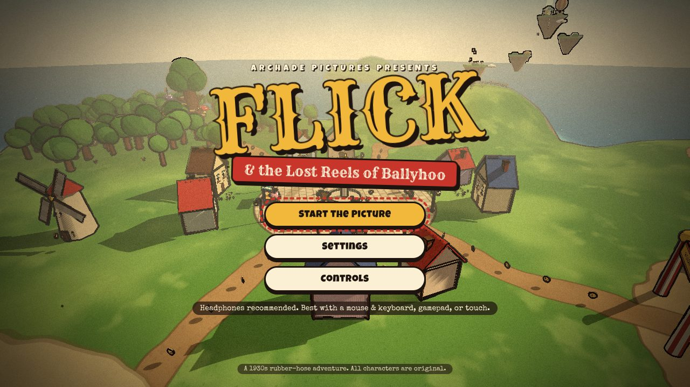
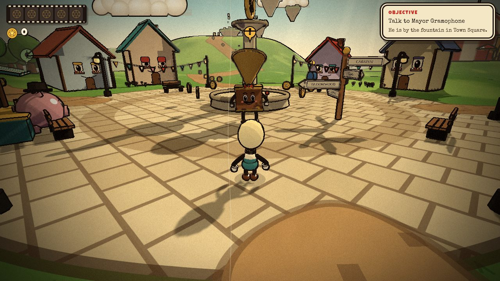
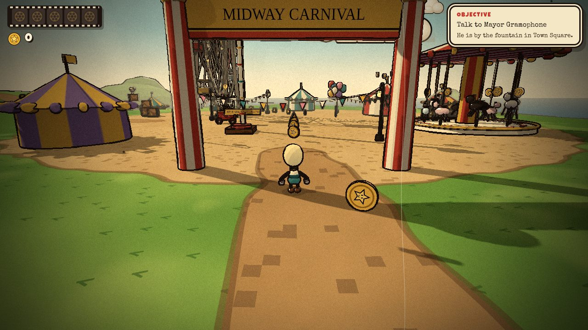
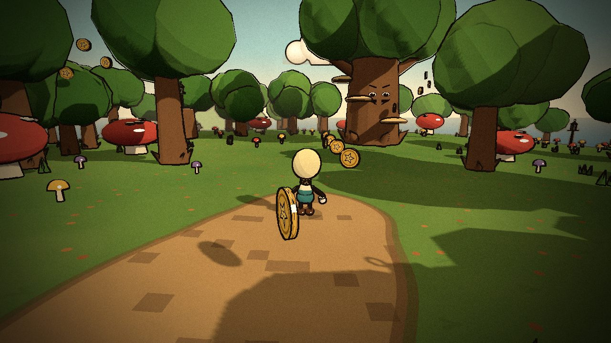
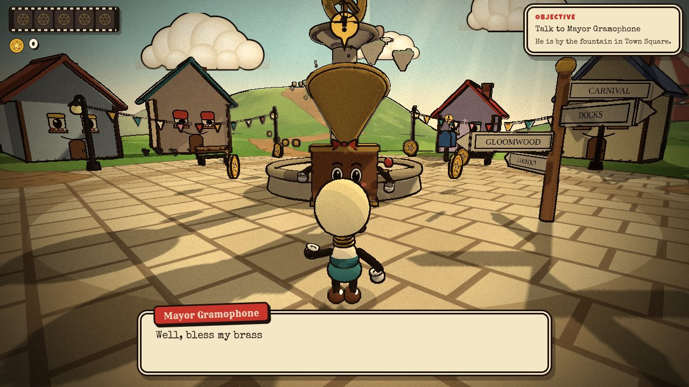
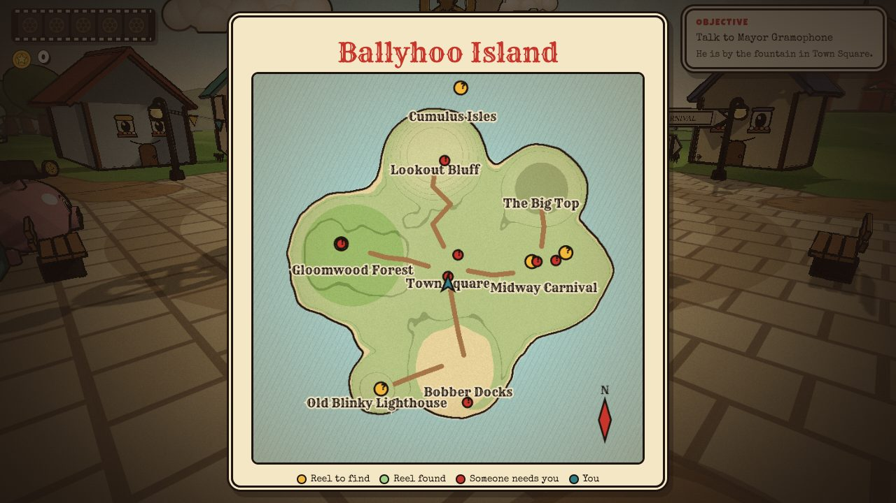
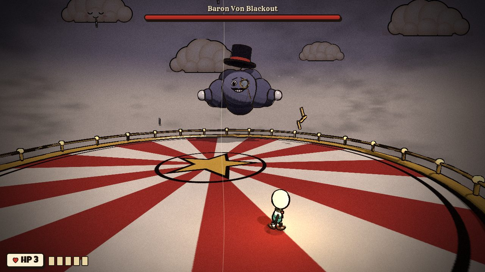

# Flick & the Lost Reels of Ballyhoo

### [▶ Play it now: archade-alpha.vercel.app](https://archade-alpha.vercel.app)

<p align="center"><a href="https://archade-alpha.vercel.app"></a></p>

A 3D exploration platformer drawn like a 1930s rubber-hose cartoon. You play **Flick**, a light-bulb kid with pie-cut eyes and noodle arms, on Ballyhoo Island the night of the Grand Picture Show. The dastardly storm cloud **Baron Von Blackout** has scattered the five film reels. Explore, help the islanders, then knock the Baron out of the sky.

Runs in the browser (WebGL 2) on desktop and mobile. Everything (art, music, sound effects) is generated in code at runtime. There are no image, model or audio files.

## Screenshots

| | |
| --- | --- |
| <br>**Town Square**: houses with window-eyes, bunting and a fountain | <br>**Midway Carnival**: Ferris wheel, carousel and striped tents |
| <br>**Gloomwood Forest**: mushrooms, faces in the trees, lanterns to light | <br>**Characters** talk in typewriter dialogue and hand out quests |
| <br>**Island map** drawn from the real terrain | <br>**Baron Von Blackout** in a three-phase boss fight |

Made by **[samidun](https://github.com/samidun26)**.

> The style is inspired by 1930s cartoons (and games like Cuphead that celebrate them). All characters, names, places and music are original.

## Run it locally

```bash
npm install
npm run dev        # http://localhost:5173
```

### Controls

| Action | Keyboard & mouse | Gamepad | Touch |
| --- | --- | --- | --- |
| Move | `W A S D` / arrows | Left stick | Drag on the left half |
| Look | Mouse (click to capture, `Esc` releases) or drag | Right stick | Drag on the right half, pinch to zoom |
| Jump / double jump | `Space` (hold for higher) | `A` | `JUMP` |
| Dash (one in midair) | `Shift` | `B` / `RB` | `DASH` |
| Talk / use | `E` | `X` | `ACT` |
| Shoot (boss) | Click / `J` | `RT` | `ACT` |
| Super (boss, 5 cards) | `Q` | `Y` | `SUPER` |
| Map | `M` | View | Map button |
| Pause | `Esc` / `P` | Menu | Pause button |

## What's on the island

- **Town Square:** Mayor Gramophone (the quest giver), Penny Piggybank's shop, Mort the Mailbox (tips), houses with window-eyes that bob to the music.
- **Bobber Docks & Old Blinky:** Captain Bobber asks you to relight the lighthouse. The upper spiral stairs were knocked out by the storm, so you jump the gaps.
- **Midway Carnival:** ride Wheely the Ferris wheel to the reel at the top, find Madame Kettlecorn's three Kernel Kids (behind a tent, on the carousel, atop a crate stack), and ring the strongman bell for bonus tokens.
- **Gloomwood Forest:** it's dark, so Flick's bulb glows. Touch five lanterns so Old Man Oak can see, then climb his shelf-fungus steps to the reel.
- **Lookout Bluff & Cumulus Isles:** Gus the weathervane points you to a launch mushroom, moving cloud platforms and a cloud elevator up to the summit isle. A hot-air balloon brings you back down.
- **The Big Top:** with five reels, Tess the Ticket sends you to the roof to fight the Baron.

**Tokens** (150 on the island) buy an Extra Heart, Twin Bolts, or a purely cosmetic Golden Bow Tie at Penny's.

**The boss** has three phases with telegraphed attacks: raindrop volleys (dark circles), gusts with tumbling top hats, lightning strikes (yellow rings) with jumpable shockwaves, hopping puff minions, a homing boomerang hat, and ground slams that leave him dizzy. If you lose, a progress track shows how far you got. Win for a KNOCKOUT, a night-time fireworks finale and a graded results card.

Progress and settings save to `localStorage`, and the game runs fine without it.

## How it's made

| Area | Approach |
| --- | --- |
| Look | Toon-shaded materials with a hand-painted mottle, then one full-screen pass that inks the image: silhouettes from depth, creases from a view-space **normal buffer** (every material writes its normal to a second render target in the same pass), plus 12 fps line boil, watercolor haze, sepia grade, grain, gate flicker, dust, scratches and vignette (`src/render/InkFilmShader.ts`) |
| Ground | Analytic island heightfield; the terrain shader paints grass strokes, flagstones with grout, inked path edges, sand and rock strata per pixel (`src/world/terrainShader.ts`) |
| Characters | Built from primitives. Rubber-hose limbs are live-updated bezier tubes (`HoseLimb`), faces are canvas textures that blink and lip-flap |
| Physics | Custom character controller vs. heightfield + yaw-rotated boxes/cylinders, one-way and bounce platforms, moving platforms that carry the player, coyote time, jump buffering, variable jump height |
| Camera | Spring-follow orbit with collision, vertical lag on jumps, auto-recenter, and a lock-on mode for the boss |
| Audio | Web Audio sequencer with three original tunes (ragtime, hot jazz, waltz): stride piano, tuba, clarinet, muted brass, brushed drums and vinyl crackle. The mix shifts per zone, and the beat clock makes the world bounce in time. All SFX are synthesized |
| Performance | Static props are merged per area and per material, with plain colors baked into vertex colors so they share draw calls. Moving groups get their rigid parts merged in local space. Three quality presets (resolution budget, shadows) |
| UI | Plain DOM/CSS over the canvas: HUD, typewriter dialogue with choices, menus, parchment map, touch controls, iris transitions. Keyboard, gamepad and touch navigable, with a "calm film effects" setting and `prefers-reduced-motion` support |

```
src/
  core/      Input, Physics, Audio, math
  render/    Renderer + ink/film shader, toon materials, normal-buffer helpers, sky, faces, textures
  world/     terrain, water, layout, props, collectibles, zones/ (town, docks, carnival, forest, bluff, scenery)
  player/    Flick model, hose limbs, controller, camera rig
  npc/       NPC framework + the cast
  boss/      Baron Von Blackout + arena and attack logic
  game/      Game state machine, quests & dialogue script, save data, overworld scene
  ui/        HUD, dialogue, screens, map, touch controls, styles
```

## Build

```bash
npm run build           # type-check + multi-file build in dist/
npm run build:single    # one self-contained dist-single/index.html (about 820 KB, 230 KB gzipped)
npm run build:artifact  # the single file, reshaped as a fragment for hosts that supply their own <html> shell
```

The only runtime dependency is `three`. Fonts load from Google Fonts with system fallbacks.

## Notes

- Needs WebGL 2. It was developed and tested in headless Chromium with software rendering, so frame rates on real hardware weren't measured. If it feels slow, drop **Settings → Picture quality**.
- Test hook: `window.__game` exposes the game object in the console, and `__game.debugTp(x, z)` teleports Flick.
